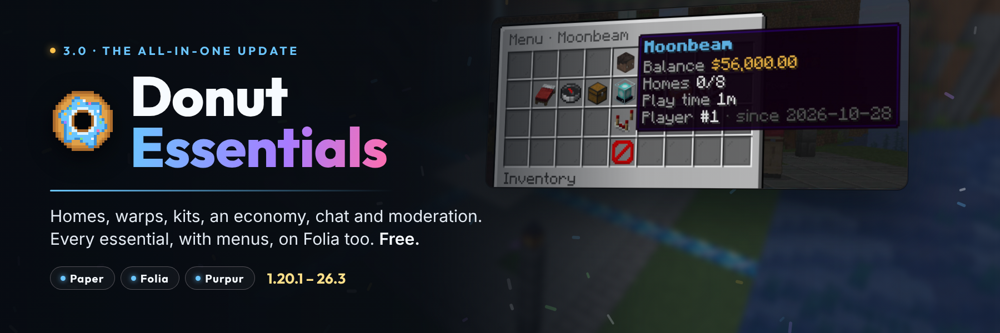

# Donut Essentials



The free, open-source **all-in-one essentials plugin** for **Paper**, **Folia** and **Purpur** on Minecraft
**1.20.1 through 26.3**.

Homes, warps, spawn, teleport requests, kits, an economy, chat, private messages and mail, AFK, nicknames, rules,
everyday utilities, and a full **moderation suite** (punishments with history, warning escalation, alt detection,
freeze, reports, staff chat, vanish, invsee, maintenance mode, IP lock) in one jar. Menus for everything, **native
dialogs** on 1.21.7+, one SQLite or MySQL database, Folia-safe throughout, and a one-command switch from EssentialsX.

Why it exists and what it does differently: [docs/MARKET-ANALYSIS.md](docs/MARKET-ANALYSIS.md). How it is built:
[docs/DESIGN-3.0.md](docs/DESIGN-3.0.md).

## Features

- **Teleports**: `/tpa` and `/tpahere` with clickable **[Accept] [Deny]**, `/back` (also to where you died), staff
  teleports. One engine for every teleport: a **title countdown** that moving or damage cancels, cooldowns and costs
  per kind, **rank tiers** for faster or cheaper teleports, and **combat tags** that block teleports out of a fight.
- **Homes**: named homes, a homes menu (icons by dimension), limits by permission or rank tier, staff access.
- **Warps and spawn**: a warps menu with item icons and visit counts, optional per-warp permissions, spawn on first
  join, on every join or on respawn, a separate spawn for new players.
- **Random teleport**: safe spots only, per-world radius, blocked biomes, chunks loaded in the background. Steps aside
  when Donut RTP is installed.
- **Kits**: made from your own inventory with **every item detail kept** (enchantments, attributes, names, lore,
  custom model data, books, potions), a kits menu with preview, cooldowns, once-only kits, costs, a first-join kit.
- **Economy**: built in and registered with Vault (another economy plugin wins automatically). `/pay` (`2.5k`, `1m`),
  `/balance`, a richest-players menu, `/eco`, payments made while you were offline are listed when you join, a daily
  economy log.
- **Chat**: formats with your permissions plugin's prefixes (Vault/LuckPerms) and PlaceholderAPI, per-group formats,
  **[item]** with the item's tooltip, **@mentions** that ping, colours by permission, anti-spam, a word filter and link
  blocking, `/chat clear|lock|slow`, join/quit/first-join messages, title broadcasts, auto announcements, nicknames.
- **Messages and mail**: `/msg`, `/r`, ignore, social spy, message toggles, and **offline mail** announced on join.
- **AFK**: `/afk [reason]`, automatic after idle minutes, `[AFK]` in the tab list, AFK players don't block night
  skipping, optional kick.
- **Moderation**: kick, (temp)ban, (temp)mute, (temp)warn, notes and IP bans with IDs, silent `-s`, reason and time
  layouts, history, `/check`, `/banlist`, `/change-reason`; **warning escalation** (3 warnings → a mute...),
  **alts** with ban-evasion alerts, **freeze**, **reports** with a staff menu, **staff chat**, **command spy**,
  **Discord** logs through a webhook.
- **Staff tools**: vanish (no join messages, no pickups, hidden from the tab list and placeholders), `/invsee`,
  `/endersee`, `/whois`, `/offlinetp`, maintenance mode with whitelist, timers and MOTD, IP lock for staff accounts.
- **Rules**: `/rules`, and optionally a **rules screen new players must accept**, a native dialog on 1.21.7+.
  **Server links** in the pause menu (1.21+). A join MOTD.
- **Utilities**: fly, god, heal, feed, speed, game modes, craft, ender chest, trash, hat, repair, top, seen, play time,
  ping, near, day/night/sun/rain, clear inventory, a **player hub menu** (`/menu`) and **personal settings**
  (`/settings`).
- **Command rules**: cooldowns and costs for **any** command, also other plugins'.
- **Built to fit in**: every module can be switched off (no commands, listeners or tasks left behind), every command
  renamed or switched off in `commands.yml`, and vanilla commands are never taken over unless you list them.

## Requirements

- Paper, Folia, Purpur or another Paper fork, **1.20.1 – 26.3**. Plain Spigot/Bukkit lack Paper's API: the plugin says
  so and disables itself.
- Java **17+** for 1.20.1–1.20.4, **21+** for 1.20.5–1.21.11, **25+** for 26.x (Minecraft's own requirements).
- Optional: Vault or VaultUnlocked (other plugins use the economy; prefixes for chat), LuckPerms or another
  permissions plugin, PlaceholderAPI, a MySQL or MariaDB server.

## Installation

1. Put `DonutEssentials-3.0.0.jar` in `plugins/`.
2. Restart the server.
3. Edit `plugins/DonutEssentials/config.yml`, `messages.yml`, `menus.yml` and `commands.yml`, then
   `/donutessentials reload` (storage, modules and commands need a restart).

### Upgrading from 2.x (or Fssentials)

Back up `plugins/DonutEssentials/` (or `plugins/Fssentials/`), replace the jar and restart. On the first start:
- punishments, IP locks and the maintenance whitelist and state move into the database (the old files are renamed
  `*.imported`);
- `config.yml` keeps your 2.x values (layouts, maintenance MOTD, broadcast format, IP lock settings; the old file is
  `config-2.x.yml`) and gains every 3.0 setting;
- `messages.yml` is replaced (yours is `messages-2.x.yml`);
- every 2.x permission (`donutessentials.punish.*`, `fssentials.*`, `plugin.iplock.admin`, `server.broadcast`...)
  still works.

See the [3.0.0 notes](DonutEssentials-3.0.0-PatchNotes.md) for what changed.

### Switching from EssentialsX

Install Donut Essentials next to EssentialsX's data folder and run:

```
/donutessentials import essentials           # a dry run: what would be imported
/donutessentials import essentials confirm   # import it
```

Balances, homes, nicknames, ignore lists, warps, the spawn (EssentialsX Spawn), kits and the server's bans come over.
Names Donut Essentials already has are kept. Then remove the EssentialsX jars.

## Commands

The full list with aliases is in `commands.yml`, where every command can be renamed or switched off. Every command has
the permission `donutessentials.command.<name>`.

| Area | Players (default: everyone) | Staff (default: op) |
| --- | --- | --- |
| Teleports | `/tpa`, `/tpahere`, `/tpaccept`, `/tpdeny`, `/tpacancel`, `/tptoggle`, `/tpauto`, `/back`, `/rtp` | `/tphere`, `/tpo` |
| Homes | `/sethome`, `/home`, `/delhome`, `/homes` | `/home <player>:<home>`, `/homes <player>` |
| Warps and spawn | `/warp`, `/warps`, `/spawn` | `/setwarp`, `/delwarp`, `/setspawn [first]` |
| Kits | `/kit [kit]`, `/kits` | `/createkit <name> [cooldown] [cost]`, `/editkit`, `/delkit`, `/kit <kit> <player>` |
| Economy | `/balance`, `/pay`, `/paytoggle`, `/baltop` | `/eco <give\|take\|set\|reset>` |
| Chat | `/realname` | `/chat <clear\|lock\|unlock\|slow>`, `/broadcast`, `/nick` |
| Messages | `/msg`, `/reply`, `/msgtoggle`, `/ignore`, `/ignorelist`, `/mail <send\|read\|clear>` | `/socialspy` |
| AFK | `/afk [reason]` | |
| Moderation | `/report` | `/kick`, `/ban`, `/tempban`, `/mute`, `/tempmute`, `/warn`, `/tempwarn`, `/note`, `/banip`, `/tempipban`, `/unban`, `/unmute`, `/unwarn`, `/unnote`, `/unpunish`, `/change-reason`, `/warns`, `/notes`, `/check`, `/banlist`, `/history`, `/punishment`, `/alts`, `/freeze`, `/reports`, `/staffchat`, `/commandspy` |
| Staff | `/playerlist` | `/vanish`, `/invsee`, `/endersee`, `/whois`, `/offlinetp`, `/maintenance`, `/iplock` |
| Rules | `/rules`, `/motd` | |
| Utilities | `/menu`, `/settings`, `/trash`, `/seen`, `/playtime`, `/ping` | `/fly`, `/god`, `/heal`, `/feed`, `/speed`, `/gm`, `/gmc`, `/gms`, `/gma`, `/gmsp`, `/craft`, `/enderchest`, `/hat`, `/repair`, `/clearinventory`, `/top`, `/near`, `/day`, `/night`, `/sun`, `/rain` |
| Admin | | `/donutessentials <info\|reload\|import essentials>` (`/dess`) |

Punishment syntax (as in 2.x): `/tempban [-s] <player> <time|#layout> [reason|@layout]`. Times: `30m`, `2h`, `3d`,
`1w`, `1mo`, `1y`.

## Permissions

| Permission | Default | Description |
| --- | --- | --- |
| `donutessentials.*` | op | Everything except the exempt and bypass nodes below that are off for everyone |
| `donutessentials.command.<name>` | see above | Use a command |
| `donutessentials.tier.<name>` | nobody | A rank tier (`teleport.tiers`, `homes.limits`): faster, cheaper teleports, more homes |
| `donutessentials.homes.<n>`, `.unlimited` | nobody | Home limit |
| `donutessentials.homes.others` | op | Other players' homes |
| `donutessentials.back.death` | everyone | `/back` after dying |
| `donutessentials.bypass.warmup`, `.cooldown`, `.cost` | op | Teleport rules |
| `donutessentials.bypass.command-rules` | op | No command cooldowns or costs |
| `donutessentials.bypass.combat` | nobody | Never tagged in combat |
| `donutessentials.tpa.bypasstoggle` | op | Send requests to players who turned them off |
| `donutessentials.warp.<name>`, `donutessentials.warps.all` | nobody / op | Per-warp access (when switched on) |
| `donutessentials.kit.<name>` | nobody | Per-kit access (when switched on) |
| `donutessentials.kit.others`, `.bypass` | op / nobody | Give kits; ignore kit rules |
| `donutessentials.balance.others` | everyone | Other players' balances |
| `donutessentials.chat.color`, `.item`, `.bypass` | op / everyone / op | Chat colours, `[item]`, skip chat rules |
| `donutessentials.nick.color`, `.others` | op | Nicknames |
| `donutessentials.msg.color`, `.bypass` | op | Private messages |
| `donutessentials.ignore.exempt` | op | Can't be ignored |
| `donutessentials.afk.kickexempt` | op | Never kicked for AFK |
| `donutessentials.notify.silent` | op | See silent punishments |
| `donutessentials.moderation.exempt`, `.mute-bypass` | nobody | Can't be punished; mutes don't apply |
| `donutessentials.moderation.ip`, `donutessentials.whois.ip` | op | See IP addresses |
| `donutessentials.alerts.alts` | op | Ban-evasion alerts |
| `donutessentials.reports.notify` | op | Report notices |
| `donutessentials.freeze.bypass` | nobody | Can't be frozen |
| `donutessentials.vanish.see`, `.others` | op | See vanished players; vanish others |
| `donutessentials.invsee.edit`, `donutessentials.endersee.edit` | op | Change items in other inventories |
| `donutessentials.maintenance.bypass`, `.notify` | op | Join during maintenance; notices |
| `donutessentials.iplock.bypass` | nobody | Join an IP-locked account from anywhere |
| `donutessentials.gamemode.<mode>`, `.others` | op | Game modes |
| `donutessentials.<fly\|god\|heal\|feed\|speed\|ping\|playtime\|clearinventory>.others` | op | Use on others |
| `donutessentials.repair.all` | op | `/repair all` |
| `donutessentials.admin` | op | `/donutessentials` and update notices |

## Placeholders

Requires PlaceholderAPI. All read memory only, so they are safe in scoreboards and tab lists.

| Placeholder | Value |
| --- | --- |
| `%donutessentials_balance%`, `_balance_formatted%`, `_balance_short%`, `_balance_raw%` | Balance (`1,065`, `$1,065.00`, `1k`, `1065.00`) |
| `%donutessentials_baltop_<n>_name%`, `_baltop_<n>_balance%`, `_baltop_<n>_balance_short%` | The richest players |
| `%donutessentials_baltop_rank%`, `%donutessentials_baltop_total%` | Your rank; all money on the server |
| `%donutessentials_homes%`, `_homes_max%`, `_homes_left%` | Homes |
| `%donutessentials_nick%`, `_nick_plain%`, `_has_nick%` | Display name |
| `%donutessentials_afk%`, `_afk_tag%`, `_afk_time%` | AFK |
| `%donutessentials_vanished%`, `%donutessentials_online%`, `%donutessentials_vanished_count%` | Vanish (online count without vanished players) |
| `%donutessentials_combat%`, `_combat_time%` | Combat tag |
| `%donutessentials_playtime%`, `_playtime_hours%`, `_first_join%`, `_join_number%` | Play time |
| `%donutessentials_tpa_toggle%`, `_msg_toggle%`, `_pay_toggle%`, `_god%`, `_fly%` | Settings |
| `%donutessentials_warns%`, `_muted%`, `_frozen%` | Moderation |
| `%donutessentials_players_total%` | Players who ever joined |

## Configuration

- `config.yml`: modules, storage, commands taken from vanilla, teleports and tiers, combat, command rules, homes, kits,
  economy, warps and spawn, random teleport, chat, announcements, messages and mail, AFK, moderation, vanish,
  maintenance, IP lock, rules, server links, MOTD, utilities, sounds, Discord, metrics. **New settings are added on
  every update; your values are never changed.**
- `messages.yml`: every message, MiniMessage or `&` codes (also `&#RRGGBB`). An empty message is not sent.
- `menus.yml`: every menu's title, size, slots, items, names and lore.
- `commands.yml`: switch commands off, rename them, add aliases.

Storage is SQLite by default. For MySQL or MariaDB set `storage.type: MYSQL` and the connection details (one server per
database; a table prefix lets several servers share a database server).

## Developer API

```java
DonutEssentialsApi api = DonutEssentials.getApi();
double money = api.balance(player);
api.homes(player).forEach(home -> player.sendMessage(home.name()));
if (api.isInCombat(player) || api.isAfk(player)) { ... }
api.teleport(player, location, "warp"); // warmup, cooldown, cost and /back like any other teleport
```

Events: `EssentialsTeleportEvent`, `TpaRequestEvent`, `HomeSetEvent`, `KitClaimEvent`, `PaymentEvent`,
`PunishmentCreateEvent` and `VanishChangeEvent` (cancellable), `BalanceChangeEvent` and `AfkChangeEvent`.

## Building and testing

```bash
./gradlew build            # the jar in build/libs, unit tests, and Folia-safety checks
./gradlew compileMatrix    # compile against every Paper API from 1.20.6 to 26.3
```

[`tools/smoke`](tools/smoke) boots real Paper and Folia servers from 1.20.1 to 26.3 and plays every module with bots,
including an upgrade from Donut Essentials 2.0.0, a switch from EssentialsX and MySQL storage.
[`tools/marketing`](tools/marketing) captures the listing's screenshots from the real game.

## Publishing

Tagged releases (`v*.*.*`) run [.github/workflows/publish.yml](.github/workflows/publish.yml): a Gradle build, then a
Modrinth version and a CurseForge file using [release/supported-minecraft.json](release/supported-minecraft.json) and
the patch notes. Repository variables `MODRINTH_ID` (`1YpSYvSs`) and `CURSEFORGE_ID` (`1487015`); secrets
`MODRINTH_TOKEN` and `CURSEFORGE_TOKEN`. The *Sync Modrinth listing* workflow updates the Modrinth page from
[`marketing/`](marketing).

## Contributing

See [CONTRIBUTING.md](CONTRIBUTING.md) and [CODE_OF_CONDUCT.md](CODE_OF_CONDUCT.md).

## Security

See [.github/SECURITY.md](.github/SECURITY.md).

## License

Licensed under the [Apache License, Version 2.0](LICENSE). See [NOTICE](NOTICE).
